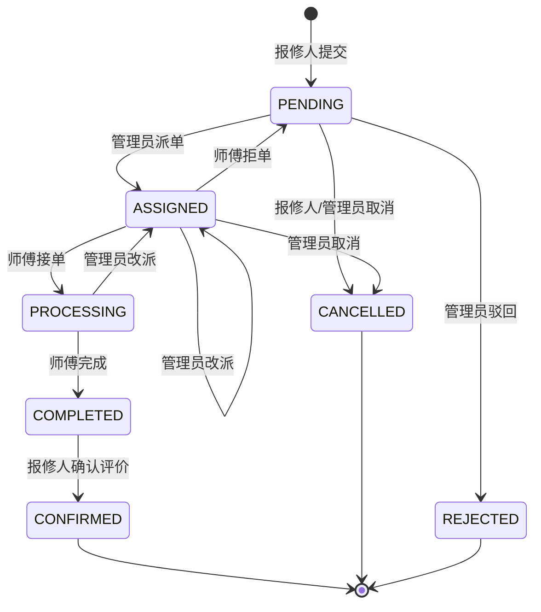

# 社区/校园报修工单系统 — 核心设计文档

> 技术栈：Spring Boot 3 + MySQL 8 + MyBatis-Plus（后端）；Vue 3 + Element Plus（管理端/维修端 Web）；uni-app（报修端）。
> 部署：单台云服务器。统一返回 `Result<T>`（code / msg / data）。
> 全局约定：
> - 状态流转全部收敛在 Service 层统一处理，Controller 不写业务逻辑；
> - **每次工单状态变更，必须在同一事务内向 `notification` 表插入通知记录**；
> - 状态用字符串枚举（`varchar`）存储，不使用魔法数字；外键用逻辑关联，不建物理外键约束。

---

## 1. 核心业务状态流转

### 1.1 状态定义

| 状态码 | 状态名 | 含义 |
| --- | --- | --- |
| `PENDING` | 待受理 | 报修人已提交，等待管理员处理 |
| `ASSIGNED` | 已派单 | 管理员已指派维修师傅，等待师傅接单 |
| `PROCESSING` | 维修中 | 师傅已接单，正在处理 |
| `COMPLETED` | 已完成 | 师傅维修完成，等待报修人确认 |
| `CONFIRMED` | 已确认 | 报修人确认并评价（终态） |
| `CANCELLED` | 已取消 | 工单被取消（终态） |
| `REJECTED` | 已驳回 | 管理员驳回（终态） |

### 1.2 流转过程（文字描述）

1. **提交**：报修人在移动端填写故障信息提交，工单创建，状态 = `PENDING`，系统通知管理员。
2. **派单**：管理员在管理端审核工单，指派维修师傅 → 状态 = `ASSIGNED`，通知被指派的师傅；若审核不通过则驳回 → `REJECTED`，通知报修人。
3. **接单**：师傅在维修端接单 → 状态 = `PROCESSING`，通知报修人（附师傅联系方式）；师傅也可拒单（填原因）→ 回到 `PENDING`，通知管理员重新处理。
4. **维修中**：师傅可记录维修过程；报修人可催单（**不改变状态**，仅通知师傅，限频）。
5. **完成**：师傅提交维修结果 → 状态 = `COMPLETED`，通知报修人确认。
6. **确认**：报修人确认并对维修打分评价 → `CONFIRMED`（终态），通知师傅评价结果。
7. **取消**：在 `PENDING` / `ASSIGNED` 状态下可取消 → `CANCELLED`（终态），记录取消原因并通知相关方。

### 1.3 各状态允许的操作与操作人

| 当前状态 | 允许操作 | 操作人 | 目标状态 | 触发通知 |
| --- | --- | --- | --- | --- |
| `PENDING` | 取消 | 报修人 | `CANCELLED` | 通知管理员 |
| `PENDING` | 派单 | 管理员 | `ASSIGNED` | 通知师傅 |
| `PENDING` | 驳回 | 管理员 | `REJECTED` | 通知报修人 |
| `PENDING` | 取消 | 管理员 | `CANCELLED` | 通知报修人 |
| `ASSIGNED` | 接单 | 维修师傅 | `PROCESSING` | 通知报修人 |
| `ASSIGNED` | 拒单 | 维修师傅 | `PENDING` | 通知管理员 |
| `ASSIGNED` | 改派 | 管理员 | `ASSIGNED`（换人） | 通知新、旧师傅 |
| `ASSIGNED` | 取消 | 管理员 | `CANCELLED` | 通知报修人、师傅 |
| `PROCESSING` | 提交完成 | 维修师傅 | `COMPLETED` | 通知报修人 |
| `PROCESSING` | 催单 | 报修人 | 不变 | 通知师傅（限频） |
| `PROCESSING` | 改派 | 管理员 | `ASSIGNED` | 通知新、旧师傅 |
| `COMPLETED` | 确认并评价 | 报修人 | `CONFIRMED` | 通知师傅 |
| `CONFIRMED` / `CANCELLED` / `REJECTED` | 无（终态） | — | — | — |

### 1.4 状态机图（Mermaid）

---

## 2. 数据库表设计

> 说明：单机小系统，表间仅逻辑关联（外键字段 + 索引），不建物理外键；时间统一 `datetime`；启用 MyBatis-Plus 逻辑删除字段 `deleted`。

### 2.1 `user` — 用户表（三端角色共用一张表）

| 字段 | 类型 | 说明 |
| --- | --- | --- |
| id | BIGINT PK AUTO_INCREMENT | 主键 |
| username | VARCHAR(50) UNIQUE NOT NULL | 登录账号 |
| password | VARCHAR(100) NOT NULL | BCrypt 加密 |
| real_name | VARCHAR(50) | 姓名 |
| phone | VARCHAR(20) | 手机号 |
| role | VARCHAR(20) NOT NULL | 角色：`REPORTER` 报修人 / `REPAIRER` 师傅 / `ADMIN` 管理员 |
| status | TINYINT DEFAULT 1 | 1 启用 / 0 禁用 |
| skill_category_id | BIGINT NULL | 师傅维修类别（关联 `category`，仅 REPAIRER 使用） |
| rating | DECIMAL(2,1) NULL | 师傅平均评分（仅 REPAIRER） |
| finish_count | INT DEFAULT 0 | 师傅累计完成单量（仅 REPAIRER） |
| avatar | VARCHAR(255) | 头像 URL |
| created_at / updated_at | DATETIME | 创建/更新时间 |
| deleted | TINYINT DEFAULT 0 | 逻辑删除 |

### 2.2 `repair_order` — 工单表（核心）

| 字段 | 类型 | 说明 |
| --- | --- | --- |
| id | BIGINT PK AUTO_INCREMENT | 主键 |
| order_no | VARCHAR(32) UNIQUE NOT NULL | 业务单号（如 `RO20261020...`） |
| reporter_id | BIGINT NOT NULL | 报修人，逻辑关联 `user.id` |
| category_id | BIGINT | 故障分类，逻辑关联 `category.id` |
| title | VARCHAR(100) NOT NULL | 故障标题 |
| description | VARCHAR(1000) | 故障描述 |
| images | VARCHAR(1000) | 图片 URL 的 JSON 数组 |
| address | VARCHAR(200) | 报修地址 |
| contact_phone | VARCHAR(20) | 联系电话 |
| status | VARCHAR(20) NOT NULL DEFAULT 'PENDING' | 见 §1.1 状态码 |
| repairer_id | BIGINT NULL | 维修师傅，逻辑关联 `user.id` |
| assign_time / accept_time / finish_time / confirm_time | DATETIME NULL | 派单/接单/完成/确认时间 |
| reject_reason | VARCHAR(200) | 驳回/拒单原因 |
| cancel_reason | VARCHAR(200) | 取消原因 |
| repair_result | VARCHAR(500) | 维修结果描述 |
| rating | DECIMAL(2,1) | 报修人评分（1~5） |
| rating_comment | VARCHAR(200) | 评价内容 |
| remind_count | INT DEFAULT 0 | 催单次数（限频用） |
| created_at / updated_at | DATETIME | 创建/更新时间 |
| deleted | TINYINT DEFAULT 0 | 逻辑删除 |

索引：`idx_reporter(reporter_id)`、`idx_repairer(repairer_id)`、`idx_status_created(status, created_at)`、`idx_category(category_id)`。

### 2.3 `notification` — 通知表（核心）

| 字段 | 类型 | 说明 |
| --- | --- | --- |
| id | BIGINT PK AUTO_INCREMENT | 主键 |
| user_id | BIGINT NOT NULL | **接收人**，逻辑关联 `user.id` |
| type | VARCHAR(20) NOT NULL | 通知类型：`ORDER` 工单通知 / `SYSTEM` 系统通知 |
| title | VARCHAR(100) NOT NULL | 标题（冗余，展示不联表） |
| content | VARCHAR(500) | 内容（冗余，展示不联表） |
| order_id | BIGINT NULL | 关联工单，逻辑关联 `repair_order.id`，点击可跳转 |
| is_read | TINYINT DEFAULT 0 | 0 未读 / 1 已读 |
| read_time | DATETIME NULL | 阅读时间 |
| created_at | DATETIME | 创建时间 |

索引：`idx_user_read(user_id, is_read, created_at)`（轮询未读数专用）、`idx_order(order_id)`。

**规则：每次工单状态变更，与状态更新同事务写入通知；一次变更可给多个接收人各插一条。**

### 2.4 `order_log` — 工单操作日志表（状态审计）

| 字段 | 类型 | 说明 |
| --- | --- | --- |
| id | BIGINT PK AUTO_INCREMENT | 主键 |
| order_id | BIGINT NOT NULL | 逻辑关联 `repair_order.id` |
| operator_id | BIGINT | 操作人，逻辑关联 `user.id` |
| operator_role | VARCHAR(20) | 操作人角色 |
| action | VARCHAR(30) NOT NULL | 动作：`SUBMIT / ASSIGN / ACCEPT / REJECT / FINISH / CONFIRM / CANCEL / REMIND` |
| from_status / to_status | VARCHAR(20) | 变更前/后状态 |
| remark | VARCHAR(200) | 备注（原因、结果摘要） |
| created_at | DATETIME | 操作时间 |

索引：`idx_order(order_id)`。

### 2.5 `category` — 故障分类表

| 字段 | 类型 | 说明 |
| --- | --- | --- |
| id | BIGINT PK AUTO_INCREMENT | 主键 |
| name | VARCHAR(50) NOT NULL | 分类名（如 水电/门窗/网络） |
| sort | INT DEFAULT 0 | 排序值 |
| status | TINYINT DEFAULT 1 | 1 启用 / 0 停用 |
| created_at | DATETIME | 创建时间 |

### 2.6 表关系总览

- `user(1) ──< repair_order(N)`：`reporter_id`（报修人）、`repairer_id`（师傅）双外键。
- `category(1) ──< repair_order(N)`：`category_id`。
- `repair_order(1) ──< order_log(N)`：`order_id`。
- `repair_order(1) ──< notification(N)`：`order_id`；`notification.user_id` 直接指向接收人（不通过工单推导）。
- 通知表冗余 `title/content`，列表展示不联查工单表，减少查询开销。

---

## 3. 核心接口清单

> 约定：统一前缀 `/api`；JWT 鉴权（`Authorization: Bearer <token>`）；统一返回 `Result<T>`；分页参数 `pageNum/pageSize`。
> ⭐ = 该接口会触发消息通知（向 `notification` 表写记录）。

### 3.1 认证模块（三端共用）

| Method | URL | 功能说明 |
| --- | --- | --- |
| POST | /api/auth/login | 登录（三端同接口，返回 token + 角色） |
| POST | /api/auth/register | 报修人注册 |
| GET | /api/auth/me | 当前登录用户信息 |

### 3.2 报修端（uni-app，报修人）

| Method | URL | 功能说明 |
| --- | --- | --- |
| ⭐ POST | /api/orders | 提交报修工单 → 通知管理员 |
| GET | /api/orders/my | 我的报修列表（分页，按状态筛选） |
| GET | /api/orders/{id} | 工单详情（含操作日志） |
| ⭐ PUT | /api/orders/{id}/cancel | 取消工单 → 通知管理员/师傅 |
| ⭐ POST | /api/orders/{id}/confirm | 确认完成并评价 → 通知师傅 |
| ⭐ POST | /api/orders/{id}/remind | 催单（限频，不改变状态）→ 通知师傅 |
| GET | /api/categories | 故障分类列表（公共） |

### 3.3 维修端（维修师傅，Web + uni-app）

| Method | URL | 功能说明 |
| --- | --- | --- |
| GET | /api/repairer/orders | 我的维修任务（分页，按状态筛选） |
| ⭐ PUT | /api/repairer/orders/{id}/accept | 接单 → 通知报修人 |
| ⭐ PUT | /api/repairer/orders/{id}/reject | 拒单（必填原因）→ 通知管理员 |
| ⭐ PUT | /api/repairer/orders/{id}/complete | 提交完成（维修结果）→ 通知报修人 |
| GET | /api/repairer/stats | 我的统计（接单数、完成数、平均评分） |

### 3.4 管理端（管理员，Web）

| Method | URL | 功能说明 |
| --- | --- | --- |
| GET | /api/admin/orders | 工单分页查询（状态/分类/时间/关键字） |
| ⭐ PUT | /api/admin/orders/{id}/assign | 派单（指定师傅）→ 通知师傅 |
| ⭐ PUT | /api/admin/orders/{id}/reassign | 改派 → 通知新、旧师傅 |
| ⭐ PUT | /api/admin/orders/{id}/reject | 驳回（必填原因）→ 通知报修人 |
| ⭐ PUT | /api/admin/orders/{id}/cancel | 管理员取消 → 通知报修人 |
| GET | /api/admin/users | 用户列表（分页，按角色筛选） |
| PUT | /api/admin/users/{id}/status | 启用/禁用用户 |
| POST / PUT / DELETE | /api/admin/categories | 分类增删改 |
| GET | /api/admin/stats/dashboard | 首页统计（待受理数、维修中数、今日新增、完成率） |

### 3.5 通知模块（三端通用）

| Method | URL | 功能说明 |
| --- | --- | --- |
| GET | /api/notifications | 我的通知列表（分页） |
| GET | /api/notifications/unread-count | 未读数（**轮询专用，轻量**） |
| PUT | /api/notifications/{id}/read | 标记单条已读 |
| PUT | /api/notifications/read-all | 全部标记已读 |

---

## 4. 多端互动通知机制（数据库表 + 前端轮询）

> 目标：单台服务器、无 RabbitMQ / WebSocket，用「同事务写库 + 前端定时轮询」实现三端消息触达，复杂度最低、可靠性最高（通知与业务数据强一致）。

### 4.1 写入侧（后端）

- 封装 `NotifyService.notify(userId, type, title, content, orderId)`，统一生成文案（如「您的报修单已派单，师傅：张三，电话：138xxxx」）。
- **与状态流转耦合**：Service 层状态变更方法加 `@Transactional`，先更新工单状态，再插入通知，保证「状态变了，通知必到」；一次变更给多个接收人批量插入多条通知。
- 通知接收人规则（对应 §3 中 ⭐ 接口）：

| 业务动作 | 通知接收人 |
| --- | --- |
| 提交报修 | 管理员 |
| 派单 / 改派 | 维修师傅（改派时含新旧师傅） |
| 接单 | 报修人 |
| 拒单 | 管理员 |
| 提交完成 | 报修人 |
| 确认并评价 | 维修师傅 |
| 取消 / 驳回 | 报修人（涉及师傅时一并通知） |
| 催单 | 维修师傅 |

### 4.2 读取侧（前端轮询）

- **轮询接口**：三端每 **30s** 调用一次 `GET /api/notifications/unread-count`，只返回 `{"unreadCount": n}`，接口走 `idx_user_read` 索引，负载极小；页面 `onShow` / 路由切换时立即补拉一次。
- **角标展示**：未读数 > 0 时更新角标 —— uni-app 用 `uni.setTabBarBadge`，Web 端用 Element Plus `el-badge`。
- **列表与已读**：用户进入消息页再分页拉取 `GET /api/notifications`；点开单条 → `PUT /api/notifications/{id}/read`；列表页提供「全部已读」。
- **状态同步复用**：工单列表/详情页同样按 30s 轮询刷新，保证三端状态实时可见（如师傅接单后报修人页面状态由「已派单」变「维修中」）。

### 4.3 细节与防刷

- 轮询接口无缓存、无中间件，MySQL 单表索引查询足够支撑单机三端规模。
- **催单限频**：同一工单 `remind_count` ≥ 3 或 30 分钟内已催过则拒绝，防止通知轰炸。
- **可选优化（后续迭代）**：将 `unread-count` 升级为长轮询 —— 服务端 hold 25s，期间有变化立即返回，超时返回空，进一步降低请求频率；前端代码无需改动。

---

## 附：文档约定速查

- 状态枚举：`PENDING / ASSIGNED / PROCESSING / COMPLETED / CONFIRMED / CANCELLED / REJECTED`
- 角色枚举：`REPORTER / REPAIRER / ADMIN`
- 通知类型：`ORDER / SYSTEM`
- 核心表：`user`、`repair_order`、`notification`、`order_log`、`category`
